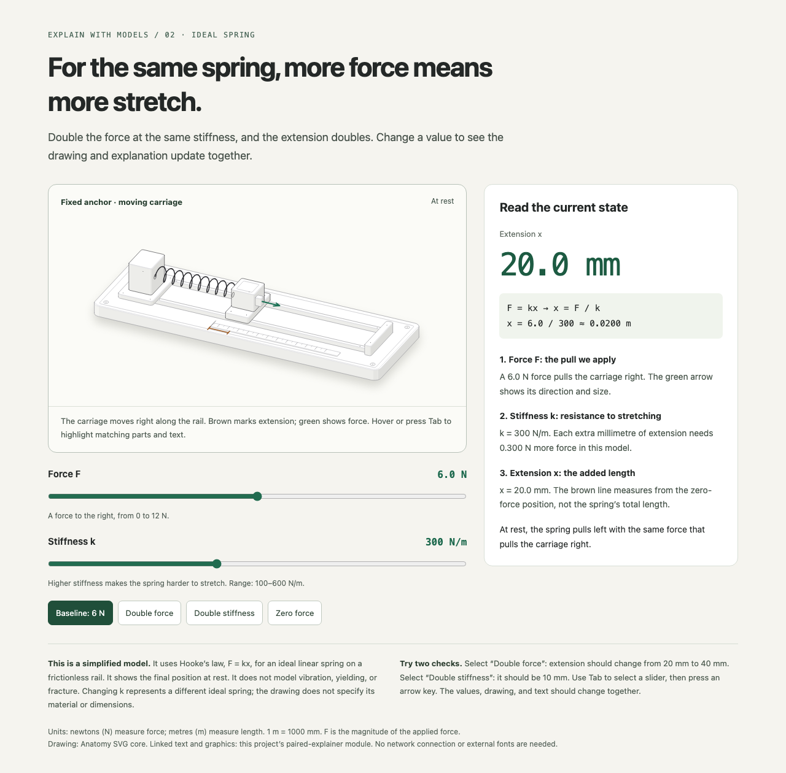

# Explain with Models

An agent skill that explains a technical idea with clear prose, a coordinated
visual, and an interactive model when one helps. Text, numbers, and highlights
come from the same state, so the reader can see what changed and why it matters.

**v0.1.1 · MIT · English documentation and examples**



## How the three parts work together

| Part | What it contributes | What this skill adds or changes |
|---|---|---|
| **STE-inspired writing** | Clear sentences, stable terms, and preservation of conditions and uncertainty; an optional English checker from [asd-ste100-skill](https://github.com/danyuchn/asd-ste100-skill) | Meaning takes priority over sentence length. Chinese uses natural clauses, not English word-count limits. |
| **Visual Explainer** | Linked text and figure emphasis, step-by-step explanations, and shared model state | A reusable [paired explanation module and template](assets/paired-explainer/) with keyboard support and useful static content. |
| **Anatomy** | Solid SVG geometry, isometric projection, shading, mechanical parts, and drawing checks | The actual [SVG core is bundled](vendor/anatomy/). Use physical illustrations when they explain the mechanism; allow useful labels and choose detail by purpose. |

The workflow starts with the reader's question and a one-sentence answer. It then
chooses prose, a table, a diagram, or a physical illustration. For interactive
work, one model drives the graphic, readout, and current explanation. Checks
cover agreement between those outputs as well as layout and operation.

The skill does not require every answer to become a machine or an application.
Anatomy's WebGL, true 3D engine, React wrappers, and community publishing are
outside this bundle. No separate Anatomy installation is needed for the
included SVG examples.

The v0.1.1 release presents the maintained documentation, example interfaces,
and preview images in English. The skill still writes in the reader's requested
language. Adapt clarity rules to that language; English word counts and the
bundled English checker do not apply to every language.

## Install as a skill

The repository root is the skill folder: it contains `SKILL.md`. Clone or copy
**the whole repository** into the skills directory supported by your agent,
with the folder name `explain-with-models`. Keep `assets/`, `references/`, and
`vendor/` beside `SKILL.md`; copying only that file omits the integrated tools.

```sh
# Replace the example destination with your agent's actual skills directory.
git clone https://github.com/Chenrui-Xu/explain-with-models.git /path/to/your/skills/explain-with-models
```

The instructions are plain Markdown and do not depend on a particular agent
runtime. Follow your agent's normal skill-discovery or reload procedure. Reading
and applying the guidance requires no package installation. Building examples,
running the checker, and running browser tests have the requirements below.

## Use

```text
Use $explain-with-models to explain how this cache key controls reuse.
Assume the reader knows basic programming. Preserve the conditions in my source.
Show what changes when one key field differs, and explain the analogy's limits.
```

```text
Use $explain-with-models to explain how spring stiffness affects extension.
Start with one sentence that answers the question. Let me change force and stiffness.
Keep the drawing, values, and explanation tied to the same state.
State the linear model's limits and identify its values as educational examples.
```

Use the invocation syntax your agent supports. You can also ask it to read
`SKILL.md` directly and follow its workflow.

## Examples and reusable pieces

- [Cache key](examples/cache-key/index.html): an English explanation with matching,
  changed-document, and changed-model states. [Source and model](examples/cache-key/).
- [Spring balance](examples/spring-balance/index.html): an Anatomy SVG figure with
  force, stiffness, displacement, and an adjacent explanation. [Build source](examples/spring-balance/build.mjs).
- [Paired starter](assets/paired-explainer/index.html): a queue example with linked
  text and shapes, previous/next controls, a step slider, and a static summary.
  Adapt the [template](assets/paired-explainer/template.html) and
  [module](assets/paired-explainer/paired-explainer.mjs) for another concept.

The built HTML pages are standalone and have no external assets. Download the
repository and open the HTML locally, or run the preview server below. A GitHub
file page shows source; it does not run the example.

## Build and check

Use Node.js 20.10 or later and Python 3.8 or later. Node.js 22 or later is
recommended for the bundled Anatomy browser tools. Python runs the optional
English checker and its regression tests; it needs only the standard library.

```sh
npm ci
npm run build
npm test
npm run validate
npx playwright install chromium
npm run test:browser
npm run preview
```

`npm run preview` serves the built examples at `http://127.0.0.1:4173`.
The paired starter can also be rebuilt directly:

```sh
node assets/paired-explainer/build.mjs
```

The tests cover model calculations, state transitions, source integrity, and
selected browser behavior. Browser checks inspect desktop and narrow layouts,
controls, fallback content, and output agreement. Read the
[behavioral evaluation cases](evals/cases.md) when changing the skill's workflow.
The [release check record](evals/release-checks.md) separates the current revision
from historical v0.1.0 evidence and states the tested scope.
An automated pass does not establish factual accuracy, complete accessibility,
or improved learning; review the source claims and the rendered explanation.

For English prose, optionally run:

```sh
python3 vendor/ste/scripts/ste-lint.py --json path/to/english-copy.md
```

The checker is read-only and reports heuristic findings. Its nonzero status is
a prompt for review, not a release requirement. It can flag valid terminology
and cannot detect lost meaning. Do not use it to grade Chinese. This project
includes no official ASD-STE100 dictionary and makes no STE-compliance claim.
See [clear writing](references/clear-writing.md) for examples and limitations.

## Contribute

Include the explanation that fails, the intended reader, and the improved
output. For code changes, run the build, tests, and validation above. For writing
or workflow changes, use a relevant behavioral case and compare meaning before
and after. Keep a limitation visible when hiding it would change the main claim.

Keep repository documentation, source text, bundled example interfaces, and
preview screenshots in English. The validator checks distributed text and HTML
language declarations. This release convention does not restrict the language
of explanations that the skill generates for a user.

Original work is copyright (c) 2026 Chenrui Xu under the [MIT License](LICENSE).
The three upstream projects retain their MIT notices and pinned provenance;
see [ATTRIBUTION.md](ATTRIBUTION.md) and the
[source comparison](references/public-sources.md). This project is independent
and does not imply endorsement by those projects or the ASD-STE100 maintainers.
